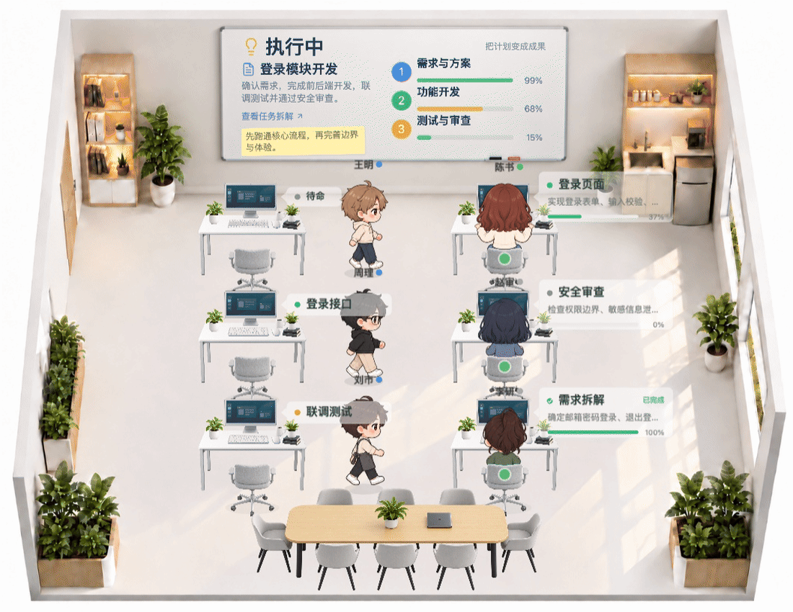

# PixOffice

[简体中文](./README.md) · **English**

[Website: pixoffice.online](https://pixoffice.online/?lang=en)

[Full Office](https://pixoffice.online/office/) · [Minimal Example](https://pixoffice.online/minimal/) · [Classroom](./example/classroom/README.md) · [Farm](./example/farm/README.md)



Recorded from the current office scene (2026-10-19, a 6-second loop at 25 fps): the wall-mounted task whiteboard, task bubbles beside monitors, walking characters and desk conversations. The recording uses local sample data. [View the full-page 3200×2000 screenshot](./docs/page-preview.jpeg).

PixOffice is a standalone 2D office frontend built with Vite, React, and PixiJS. Replaceable business data sources provide metrics, tasks, and employee information. The scene runtime drives characters, objects, and activities through a versioned protocol and trusted built-in plugins. Without a connected business service, the interface uses clearly labeled sample data.

It includes six frame-animated characters, seated poses and office assets, with support for switching between offices, desk visits, group meetings, sustained focus, a structured task whiteboard, timed confirmations and choice menus, plugin controls, and grid-based drag-and-drop layouts.

Maps and character movement use integer grid cells. Each scene package defines furniture footprints, entrance cells, use cells and resource reservations. Smooth motion is interpolated only in the rendering layer. The current command protocol is `2.0`; see [Integer Grid and Furniture Interactions](./docs/integer-grid-and-interactions.md).

[Office Business Integration](./docs/office-integration.md) · [Dashboard Data Integration](./docs/dashboard-integration.md) · [Plugins, Scene Protocol, and External Integration](./docs/plugin-runtime.md) · [Map Editor and AI Editing Protocol](./docs/map-editor.md) · [Message Relay and Deployment](./docs/message-relay.md)

[Scene Extensions and Animation Architecture](./docs/architecture/README.md) covers independent office, classroom and farm packages, the shared runtime, frame animation, and integration interfaces. The classroom supports lectures and student answers. The farm supports planting, watering, growth, harvest and automatic care. A skeletal animation engine is not implemented yet.

The website supports Chinese and English. The example interfaces, screenshots, and linked technical documentation are currently in Chinese.

## Packages and Examples

The project uses eleven npm workspace packages. Five generic packages define the core boundaries: `protocol`, `contracts`, `runtime`, `renderer-pixi`, and `animation-frame`. The optional office, classroom and farm pairs (`scene-*`, `assets-*`) are peers and do not depend on each other.

- [Full Office](./example/office-web): the React interface, chat, editor, and HTTP integration.
- [Minimal Example](./example/minimal-vanilla): an office assembled only through public package exports, without React.
- [Independent Scene](./example/isolated-scene): one walking character, without either office package. Run `npm run dev:isolated`.
- [Independent Classroom](./example/classroom): lectures, student answers and a live blackboard. Run `npm run dev:classroom`; `npm run build:classroom` produces an independent deployment without office resources.
- [Independent Farm](./example/farm): two farmers, six plots, three vegetables and a complete planting cycle. Run `npm run dev:farm`; `npm run build:farm` excludes office and classroom resources. Local saves preserve progress; growth pauses offline.
- [Dimetric Assembly](./example/dimetric): an independent 2:1 product validation entry. Run `npm run dev:dimetric` or `npm run build:dimetric`. It shares protocols and runtime but owns its projection and save namespace, with no classic scene assets. Diagnostic markers are not final pixel artwork. See [Dual-Product Architecture](./docs/architecture/dual-products.md).
- [Architecture and Responsibilities](./docs/architecture/README.md): dependency direction, asset delivery, and entry points for scene and skeletal animation development.

Use `npm run packages:build` to build the packages, `npm run packages:check` to check boundaries, and `npm run packages:smoke` to install the packaged tarballs outside the repository for validation. The code packages are developed within this repository and have not been published to npm. Assets are deployed separately and can be exported with `npm run assets:export -- /absolute/path/to/new-public-directory`.

Scenes are lazily assembled through `SceneAssembly`. Furniture and individual characters can be exported from versioned catalogs; see [Scene Isolation and Selective Delivery](./docs/architecture/scene-isolation.md). The independent example has its own public directory. The complete website still includes office resources.

## Office Chat

A floating input sits at the bottom of the animated scene. Sending a message expands the conversation panel upward. An animated multicolor border indicates generation, with controls to stop, collapse, or start a new conversation. By default, this is a clearly labeled interaction preview: it does not call a model or execute tasks. Connect a real streaming service through `VITE_PIXOFFICE_CHAT_URL` or the `chatSource` prop of `OfficeApp`. See the [Chat Integration Protocol](./docs/chat-integration.md).

In the local preview, starting the demo shows one confirmation in the current office after about 15 seconds and one side choice card from another office after about 30 seconds. Each run contains only these two questions, with no follow-up queue. Each question receives a fresh deadline when it appears. Stopping the demo cancels questions that have not appeared yet. Connected-backend menus are still triggered by backend requests.

## Map Editing

The grid button in the top-right corner of the office opens the full-screen layout editor; the top-left button opens the team-space overview. Choose assets from the furniture catalog at the bottom, drag furniture onto the floor grid, and select it to duplicate, remove, or reassign a workstation. Invalid placements return to their previous positions. Undo and redo are supported; the advanced menu offers JSON import/export and route testing. External AI systems can modify the same shared draft through the `map.edit` protocol without simulating mouse input.

## Updating Preview Media

With Chrome and FFmpeg installed, run `npm run docs:capture` to build the current version and record the office, replacing the GIF and high-resolution screenshot above. To update only the GIF while preserving the existing screenshot, run `node scripts/capture-readme.mjs --gif-only` after building. Recording uses local sample data in an isolated browser, without connecting to a business backend or changing your regular saved state.

## Character Asset Packs

The six existing characters have independent asset packs under `art/characters/packs/<character-id>/`. Each action is maintained separately. The build generates atlases, frame coordinates, and the character registry. The office and preview share sizing, anchor, and action-sampling contracts.

```bash
npm run characters:build  # Validate admission and build published character packs
npm run characters:check  # Verify source assets match generated resources
```

`npm run dev`, `npm run build`, and `npm test` build these assets automatically. Character atlases and initial office assets use lossless WebP, preserving current PNG sources, frame coordinates, and action timing. The generated `public/characters/` directory and generated office `.webp` files are not tracked in Git. Early character sheets, rejected design drafts and stale generated files have been removed; current character packs and the production sources for active artwork remain.

On first load, the page draws a white surface and the office background, then loads the initial character packs (seated and working poses) alongside the desks and chairs. Regular textures have a concurrency limit of four; the background loads independently with priority. Progress shows the actual number of completed resources. Sidebar avatars use separate small images instead of full animation atlases. Other poses required by a saved scene are loaded as needed. Manifests must declare `startup` / `deferred` atlas groups, and registry entries must include a separate `portrait`. Retired formats are rejected; missing actions are never silently replaced with other actions.

Once the office is visible, current work animations continue while the remaining walking, talking, and expression assets load in the background. Scene interactions, demos and editing controls become available when preparation finishes. On failure, the visible scene is preserved and a retry is offered. The browser performance timeline exposes three marks: `pixoffice:background-visible`, `pixoffice:scene-ready` (initial scene visible), and `pixoffice:actions-ready` (full interaction ready). The scene simulation clock does not advance during background loading. Hosts using the headless runtime directly should wait for assets to be ready before advancing the visual simulation.

[Character Configuration and Action Standards](./docs/character-packs.md) · [Character Admission, Visual Review, and Release](./docs/character-admission.md)

New or modified characters must first pass through the staging workflow: `characters:draft → characters:audit → characters:preview → characters:review → characters:publish`. Work frames are checked for body stability, and walking cycles for continuity. Publication requires visual approval tied to that asset version. Freeze markers for existing assets are documented in each character configuration.

Check the rights and licenses for any assets you use.

## Third-Party Software Licenses

Production builds automatically generate [Third-Party Licenses and Attributions](./public/THIRD_PARTY_NOTICES.txt) and publish them alongside the project license at `/THIRD_PARTY_NOTICES.txt` and `/LICENSE.txt`. Commit updated notices after dependency upgrades. Run `npm run licenses:check` to detect missing, stale, or unreviewed licenses. These notices cover software dependencies only; they do not establish permission to use image assets. See [License Maintenance](./licenses/README.md).

## Running Locally

Use Node.js 24 LTS (minimum supported: Node.js 22.13). Prefer `npm ci` for a locked installation.

```bash
npm install
npm run dev:vite
```

The development server serves the project website at `/`. Navigation opens the full office at `/office/`, the minimal example at `/minimal/`, the classroom at `/classroom/`, and the farm at `/farm/`. `npm run build` generates all five pages in the root `dist/` directory for deployment.

The frontend-only demo uses local business data. In server mode, the backend pushes offices and task snapshots without business polling. Run `npm run dev`, open `/office/`, then run `npm run integration-example` in another terminal to exercise initialization, task delivery, user confirmation and completion. See [Office Business Integration](./docs/office-integration.md) for the contract and runnable backend example.

## Messaging and Deployment

One repository and one React build: Vercel publishes only `dist/` as a local-data demo, without a backend connection or Functions. Docker serves the same frontend alongside Fastify and enables integration at runtime.

`npm run dev` starts Vite and Fastify; the office page waits for initialization data from the external business backend. Use `npm run dev:vite` for a frontend-only demo. The external business backend calls the PixOffice server over HTTP POST. PixOffice manages the SSE connection between its server and browser pages to deliver business state and scene commands.

- POST URL: `http://localhost:8765/api/pixoffice/messages`
- Header: `Authorization: Bearer pixoffice-demo-key`
- Browser runtimes own animation scheduling, deduplication, expiry and cancellation. Fastify caches the latest full snapshot per office, never animation history. New or reconnected SSE clients automatically recover current state without rebuilding existing runtimes.
- Snapshots include a monotonically increasing per-office `seq` and structured `whiteboard` data. Offline snapshots return HTTP 202 (cached, not browser-ready); online application returns 200. Offline animations and decisions return 409; decisions time out with 408 and no default choice.
- The default key is a public demo value. Override `PIXOFFICE_API_KEY` for public deployment; custom keys never enter the frontend build.
- Messages support `offices.initialize`, `office.snapshot`, `office.read`, `office.capabilities`, `decision.request`, `ui.next` and `ui.respond`. Run `npm run integration-ui-example` to handle actor clicks and task actions and return dialogs or whiteboard snapshots. The conversation input uses the [Chat Streaming API](./docs/chat-integration.md).

See [Message Relay and Deployment](./docs/message-relay.md) for boundaries, batches, security and Docker details.

```bash
docker build -t pixoffice .
docker run --rm -p 3000:3000 -e PIXOFFICE_API_KEY=your-private-key pixoffice
```

Open `http://localhost:3000/office/`, then POST to `/api/pixoffice/messages` on the same host.

## HTTP Messages

Business requests are JSON objects containing `type` and the operation's parameters, such as `{"type":"office.read","teamId":"office-1"}`. Scene requests contain `teamId` and `command`, whose `sceneId` matches `teamId`. HTTP responses contain `code`, `msg` and an object-valued `data`. All protocol values prohibit `null`. See the [Office HTTP Integration Guide](./docs/office-integration.md) for field definitions and examples.

This desk-visit example targets `office-1`, created by `integration-example`. Keep the office page online when sending it:

```bash
curl -X POST http://localhost:8765/api/pixoffice/messages \
  -H 'Authorization: Bearer pixoffice-demo-key' \
  -H 'Content-Type: application/json' \
  -d '{"teamId":"office-1","command":{"protocolVersion":"2.0","sceneId":"office-1","commandId":"visit-1","type":"activity.start","capability":"office.visit","participants":[{"entityId":"office-lead","role":"visitor"},{"entityId":"code-agent","role":"host"}],"params":{"stops":[{"hostId":"code-agent","message":"Please take over this task."}]}}}'
```

The following JSON examples define scene commands. Place each command in the top-level `command` field when sending an HTTP request:

```json
{
  "protocolVersion": "2.0",
  "sceneId": "office-1",
  "commandId": "visit-1",
  "type": "activity.start",
  "capability": "office.visit",
  "participants": [
    { "entityId": "office-lead", "role": "visitor" },
    { "entityId": "code-agent", "role": "host" }
  ],
  "params": { "stops": [{ "hostId": "code-agent", "message": "Please take over this task." }] }
}
```

Visit several desks in sequence:

```json
{
  "protocolVersion": "2.0",
  "sceneId": "office-1",
  "commandId": "tour-1",
  "type": "activity.start",
  "capability": "office.visit",
  "participants": [
    { "entityId": "office-lead", "role": "visitor" },
    { "entityId": "code-agent", "role": "host" },
    { "entityId": "search-agent", "role": "host" }
  ],
  "params": {
    "stops": [
      { "hostId": "code-agent", "message": "Please implement the feature." },
      { "hostId": "search-agent", "message": "Please gather the supporting data." }
    ]
  }
}
```

Set an employee's state:

```json
{
  "protocolVersion": "2.0",
  "sceneId": "office-1",
  "commandId": "work-1",
  "type": "actor.presentation.set",
  "actorId": "office-lead",
  "status": "working",
  "title": "Organizing market intelligence...",
  "sourceRevision": 1
}
```

Use a new `commandId` for each new command; resubmitting the same ID is deduplicated. Target characters by stable entity IDs, not display names or roster numbers. Increment `sourceRevision` for each business presentation update to the same character.

## Contact

For discussions or collaboration, scan this WeChat QR code.


