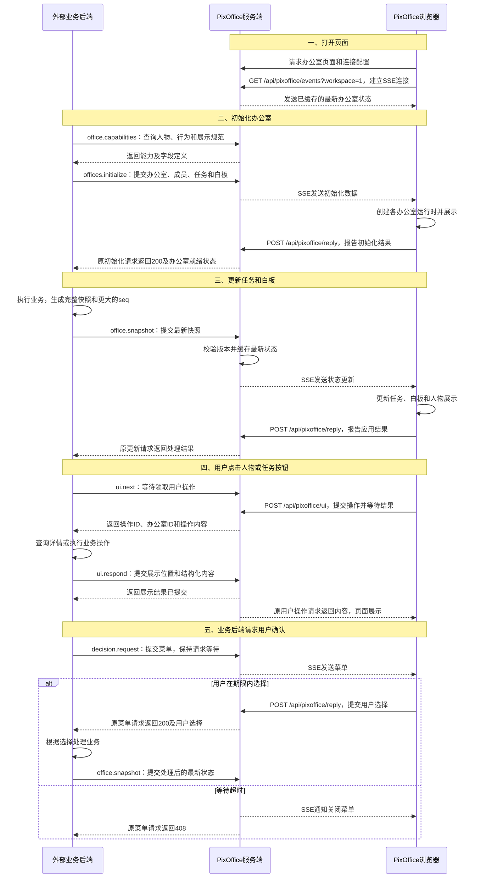
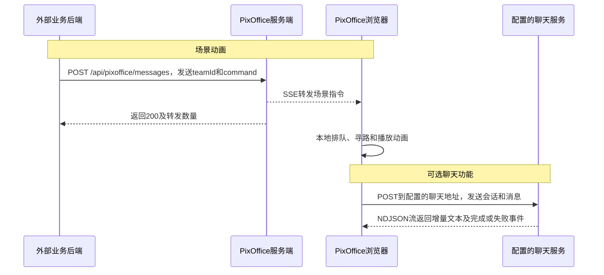

# PixOffice 办公室 HTTP 接入协议

本文面向将业务系统、智能体服务或任务平台接入 PixOffice 的开发者。通过本协议，可以创建办公室、展示成员与任务、更新白板、控制场景行为，以及接收用户操作。

## 通信参与方

| 名称 | 职责 |
| --- | --- |
| 外部业务后端 | 提供办公室、成员、任务和白板数据，执行业务操作，调用 PixOffice HTTP 接口 |
| PixOffice 服务端 | 本项目提供的 Fastify 服务，校验请求、缓存最新业务状态，并将消息发送给浏览器 |
| PixOffice 浏览器页面 | 展示办公室，执行人物动画，接收用户点击和选择 |

外部业务后端调用 PixOffice 服务端。PixOffice 服务端通过 SSE 向浏览器页面发送消息；SSE 是从服务器向浏览器持续发送事件的 HTTP 连接，由 PixOffice 自行建立和管理。

```text
外部业务后端 -- POST /api/pixoffice/messages --> PixOffice 服务端
PixOffice 服务端 -- SSE 消息 --> PixOffice 浏览器页面
外部业务后端 <-- 同一次 HTTP 请求的响应 -- PixOffice 服务端
```

## 完整调用流程

以下流程以服务器部署、浏览器页面在线为例。外部业务后端发送的 `office.capabilities`、`offices.initialize`、`office.snapshot`、`ui.next`、`ui.respond` 和 `decision.request`，均为 `POST /api/pixoffice/messages` 请求体中的 `type`。

图中的 `/api/pixoffice/events`、`/api/pixoffice/reply` 和 `/api/pixoffice/ui` 由 PixOffice 浏览器代码调用。各操作的字段定义见后续章节。



用户操作采用领取方式：外部业务后端持续调用 `ui.next`，处理领取到的操作后用 `ui.respond` 返回展示结果。`ui.next` 每次返回后可再次调用；到期没有操作时返回空列表。详情内容通过浏览器先前发起的 `/api/pixoffice/ui` 请求返回。

### 场景动画与可选聊天



动画请求的成功响应表示已转发，业务完成状态由外部业务后端决定。聊天服务可以由外部项目提供，接口格式见[聊天流式接口](./chat-integration.md)。

初始化和状态更新返回 `202` 时，表示最新状态已缓存，但该请求没有取得浏览器的应用确认。它可能发生于页面离线，也可能发生于等待浏览器确认的请求容量已满；后一种情况下，在线页面仍可通过 SSE 收到状态。浏览器上线或 SSE 重连时接收最新快照。服务端重启后，外部业务后端需要重新发送初始化。详细版本规则见下文“恢复与顺序”。

## 快速开始

需要 Node.js 22.13+ 或 24+。在项目根目录安装依赖并启动开发服务：

```sh
npm install
npm run dev
```

打开启动日志中 Vite 地址的 `/office/` 页面。在另一个终端运行业务接入示例：

```sh
npm run integration-example
```

该示例创建两个办公室、绑定业务成员、更新任务与白板，并等待用户在页面选择确认或拒绝。运行 `npm run integration-ui-example` 可以接收人物点击和任务按钮操作，并返回详情内容。示例源码位于 [`integration/clients/`](../clients/)。

执行 `npm run test:integration` 可运行独立 HTTP 客户端、真实浏览器和临时 Docker 服务之间的自动验收，覆盖初始化、用户操作、菜单、状态同步及异常恢复。环境要求、范围和报告位置见[端到端验收说明](../../tests/integration-e2e/README.md)。

示例客户端通过 `PIXOFFICE_URL` 指定 PixOffice 服务地址，默认 `http://127.0.0.1:8765`；通过 `PIXOFFICE_API_KEY` 指定访问密钥。开发环境默认密钥为公开演示值 `pixoffice-demo-key`。服务器与 Docker 配置见[消息转发与部署](./message-relay.md)。

下文请求示例使用 `team-a` 作为办公室 ID；首次调用时先执行“初始化办公室”，再发送该办公室的状态更新、菜单和场景指令。

## HTTP 地址与认证

所有办公室业务操作和场景指令都发送到同一个地址：

```http
POST <PixOffice 服务地址>/api/pixoffice/messages
```

每次请求设置以下请求头：

```http
Authorization: Bearer <PIXOFFICE_API_KEY>
Content-Type: application/json
```

将 `<PIXOFFICE_API_KEY>` 替换为与 PixOffice 服务端配置一致的密钥。

## 请求与响应格式

请求体为 JSON 对象。业务请求用 `type` 指定操作，其余字段是该操作的参数。例如，查询办公室 `team-a`：

```json
{ "type": "office.read", "teamId": "team-a" }
```

场景动画请求的顶层字段为 `teamId` 和 `command`，完整示例见下文“发送场景指令”。

每次 HTTP 请求都返回以下结构：

| 响应字段 | 类型 | 含义 |
| --- | --- | --- |
| `code` | 整数 | 与 HTTP 状态码一致 |
| `msg` | 字符串 | 供人阅读的结果说明；程序应根据 `code` 和业务字段判断结果 |
| `data` | 对象 | 该操作的返回数据；列表存放在对象内，例如 `data.offices`、`data.actions` |

例如，等待用户操作时暂时没有可领取的操作，返回：

```json
{ "code": 200, "msg": "OK", "data": { "actions": [] } }
```

失败响应的 `data` 包含 `reasonCode`、`details` 和 `issues`：

```json
{
  "code": 400,
  "msg": "Invalid business message",
  "data": { "reasonCode": "INVALID_MESSAGE", "details": {}, "issues": [] }
}
```

`reasonCode` 用于区分失败原因，`details` 提供补充信息，`issues` 提供字段校验问题。字段类型、必填项和取值范围的机器可读定义（JSON Schema），可通过 `office.capabilities` 查询。

### 通用数据规则

- 请求和响应的任何层级都禁止 `null`。字段必须符合各操作定义的类型。
- 可选字段可以省略。业务快照中的可选文本默认 `""`、列表默认 `[]`、在线标记默认 `false`，未知进度和资源指标默认 `-1`；对象按其字段定义补齐默认结构。
- 办公室 ID、任务名称、版本、时间等必填字段必须提供有效值。具体必填项见各操作及[业务快照字段说明](./dashboard-integration.md)。
- 办公室、场景人物、命令和交互 ID 使用 1–100 个字符，允许英文字母、数字、`_`、`.`、`:`、`-`。业务成员和任务 ID 为 1–100 个字符的非空字符串。
- 时间使用包含时区的 ISO 8601 格式，例如 `2026-10-18T10:00:00Z`。
- JSON 对象嵌套最多 64 层，禁止 `__proto__` 属性。单次请求体最大 64 KiB。
- 业务请求只接受对应 JSON Schema 声明的字段；校验失败返回 `400`。

## 操作与返回时机

| 请求内容 | 返回时机 |
| --- | --- |
| `offices.initialize` | 取得浏览器逻辑初始化结果后返回 `200`；已缓存但未等待浏览器确认时返回 `202` |
| `office.snapshot` | 取得浏览器应用结果后返回 `200` 和 `applied`；已缓存但未等待浏览器确认时返回 `202` 和 `cached`；较旧状态返回 `200` 和 `ignored`；相同版本、相同内容可重试同步 |
| `office.read` | 返回办公室目录，或等待在线页面返回指定办公室的状态 |
| `office.capabilities` | 服务端立即返回人物、物品、行为及 UI 的 JSON Schema，初始化前也可查询 |
| `ui.next` | 领取一个用户操作；等待时间内没有操作则返回 `data.actions: []` |
| `ui.respond` | 服务端接收指定用户操作的展示结果后返回 |
| `decision.request` | 等待用户选择后返回；到期返回 `408` |
| `{teamId, command}` | 指令发送到在线页面连接后返回 `200`；播放由浏览器随后执行 |

初始化、状态更新和状态查询等待浏览器处理的默认时限为 10 秒。菜单等待时限默认 60 秒，`timeoutMs` 可设为 1000–300000 毫秒。外部业务后端和反向代理的 HTTP 超时应大于相应等待时限，例如为最长菜单配置 310 秒。

## 1. 初始化办公室

`offices` 为办公室快照数组，每项包含办公室身份及完整业务状态：

```json
{
  "type": "offices.initialize",
  "offices": [{
    "schemaVersion": "1.0",
    "seq": 1,
    "whiteboard": { "template": "task-board-v1", "title": "", "status": "queued", "steps": [] },
    "workspace": { "id": "team-a", "name": "研发办公室" },
    "employees": [
      { "id": "coding", "sceneActorId": "office-lead", "name": "代码开发", "online": true },
      { "id": "testing", "sceneActorId": "office-lead", "name": "自动化测试", "online": true }
    ],
    "tasks": [{
      "id": "task-1", "title": "登录模块开发", "assigneeId": "coding",
      "status": "running", "summary": "实现登录与权限校验。", "updatedAt": "2026-10-18T10:00:00Z"
    }],
    "events": []
  }]
}
```

- `workspace.id` 是办公室的稳定 ID，其他操作的 `teamId` 引用该值。
- `employees` 是业务成员列表，可代表员工、功能或智能体。`id` 在该办公室内唯一；`sceneActorId` 指定负责展示该成员的场景人物。多个成员可以绑定同一人物。
- 每个办公室提供固定六个人物及对应工位、外观。可绑定人物通过 `office.capabilities` 的 `data.scene.actors`，或初始化结果的 `data.actors` 查询。
- 初始化按 `workspace.id` 新增或更新办公室。请求未列出的办公室保留；此操作不提供删除办公室功能。一个服务实例最多管理 100 个办公室。
- 新增办公室时，其他办公室继续执行各自活动。更新已有办公室使用完整快照和 `seq` 规则，见下文“恢复与顺序”。
- 返回的 `data` 包含 `offices`、`actors`、`supportedMessages`、`sceneCommandProtocol` 和 `ui`。每项 `offices` 含 `id`、`name`、`seq`、`runtimeReady`、`taskCount`。
- `runtimeReady: true` 表示浏览器已创建该办公室的逻辑运行环境；图片资源按需加载。返回 `202` 时，目录中的 `runtimeReady` 为 `false`，表示此响应尚未取得浏览器就绪确认；即使页面实际在线，也应按未确认处理。

## 2. 更新任务与展示状态

```json
{
  "type": "office.snapshot",
  "teamId": "team-a",
  "snapshot": {
    "schemaVersion": "1.0",
    "seq": 2,
    "whiteboard": { "template": "task-board-v1", "title": "", "status": "queued", "steps": [] },
    "workspace": { "id": "team-a", "name": "研发办公室" },
    "employees": [{ "id": "coding", "sceneActorId": "office-lead", "name": "代码开发" }],
    "tasks": [{
      "id": "task-1", "title": "登录模块开发", "assigneeId": "coding",
      "status": "completed", "progress": 100, "summary": "实现登录与权限校验。", "updatedAt": "2026-10-18T10:05:00Z"
    }],
    "events": []
  }
}
```

`snapshot` 表示该办公室在此版本下的完整业务状态；数组内容替换该办公室对应列表，省略的可选字段使用默认值。`teamId` 必须等于 `snapshot.workspace.id`，办公室必须已初始化。完整字段、数量限制和状态见[业务快照规范](./dashboard-integration.md)。

外部业务后端负责汇总该办公室的完整数据，并为每次更新生成更大的 `seq`。PixOffice 根据 `seq` 选择最新状态，因此 HTTP 请求可以乱序到达。

成功响应的 `data` 包含 `teamId`、`seq`、`status`。`status` 为 `applied`、`cached` 或 `ignored`，分别表示浏览器已确认应用、服务端已缓存但未取得浏览器确认、版本未更新；忽略原因由 `reasonCode` 给出。`cached` 和 `ignored` 均不证明页面已经应用该版本。

任务状态、简介和业务进度由外部业务后端维护。电脑旁的进度条是活动展示：进行中最多显示 99%，收到 `completed` 后显示 100% 并保留完成内容；任务列表使用快照中的真实进度。多个成员绑定同一人物时的任务展示规则见[业务快照规范](./dashboard-integration.md)。

用户点击任务按钮后，外部业务后端通过 `ui.next` 接收操作，处理完成后发送新快照，流程见“处理用户操作”。

## 3. 请求用户确认或选择

```json
{
  "type": "decision.request", "teamId": "team-a", "timeoutMs": 60000,
  "decision": {
    "id": "decision-1", "actorId": "office-lead", "kind": "confirmation",
    "title": "是否提交登录模块？", "description": "请检查实现结果后决定。",
    "confirmLabel": "确认提交", "rejectLabel": "暂不提交"
  }
}
```

多选项菜单使用以下请求，允许 2–8 个选项：

```json
{
  "type": "decision.request", "teamId": "team-a", "timeoutMs": 60000,
  "decision": {
    "id": "decision-2", "actorId": "office-lead", "kind": "choice",
    "title": "下一步如何处理？", "description": "请选择处理方式。",
    "options": [
      { "id": "submit", "label": "提交", "description": "进入下一阶段" },
      { "id": "revise", "label": "继续修改", "description": "补齐问题后再提交" }
    ]
  }
}
```

`decision.id` 为本次菜单的唯一标识，每次发起新菜单应使用不同值。选项 ID 在该菜单内唯一。`actorId` 可省略，默认使用第一个场景人物；人物姓名和头像由 PixOffice 根据人物 ID 确定。

用户选择后，发起菜单的 HTTP 请求返回：

```json
{
  "code": 200, "msg": "User selected",
  "data": { "teamId": "team-a", "decisionId": "decision-1", "choiceId": "confirm", "label": "确认提交" }
}
```

确认菜单返回 `choiceId: "confirm"` 或 `"reject"`；多选项菜单返回所选选项的 ID。`label` 为对应按钮标签。收到结果后，由外部业务后端执行业务操作并发送更新后的快照。

菜单按所属办公室排队，切换办公室时保留。非当前办公室的菜单会在场景左侧显示所属团队、问题、选项或确认按钮，可直接提交而不切换办公室；也可通过“进入办公室”查看上下文。提交仍返回该菜单原请求对应的 `teamId` 和 `decisionId`，不增加后端接口。空间总览显示各办公室的待选择数量。页面显示倒计时，到期关闭菜单并返回 `408`，不产生默认选择。当前接口不提供菜单请求重试去重或历史结果查询；网络中断后，调用方应根据业务状态决定是否发起新菜单。

## 4. 查询初始化和当前任务

```json
{ "type": "office.read" }
```

省略 `teamId` 或使用 `teamId: ""` 时，返回办公室目录。`data` 结构与初始化结果相同，包含各办公室的任务数量、版本与就绪状态，以及可绑定人物和 UI 能力。

查询指定办公室：

```json
{ "type": "office.read", "teamId": "team-a" }
```

返回 `data.snapshot`（完整业务快照）、`data.scene`（人物、物品和场景行为描述）及 `data.pendingDecisions`（等待选择的菜单 ID 列表）。办公室未在当前服务端初始化时返回 `404 OFFICE_NOT_INITIALIZED`；已初始化但无在线浏览器页面时返回 `409`。

### 查询能力与字段 Schema

```json
{ "type": "office.capabilities" }
```

返回的 `data` 包含：

| 字段 | 内容 |
| --- | --- |
| `scene` | 人物 ID、物品 ID、物品状态结构、行为参数、参与者角色和人数限制 |
| `ui` | 展示位置、内容格式、用户操作及白板的 JSON Schema |
| `requests` | 业务请求的 JSON Schema |
| `responses` | 业务成功结果和错误结果的 JSON Schema；用于校验响应中的 `data` |

初始化之前即可调用该操作。指定办公室的实时场景状态通过 `office.read` 查询。

请求、展示内容、白板、场景行为参数和物品状态的 Schema 描述可提交的输入：带默认值的字段可以省略。响应 Schema 描述返回的数据：应补齐的默认字段会实际出现在响应中。身份及跨字段引用约束同时由服务端校验。

## 5. 固定格式白板

通过 `offices.initialize` 或 `office.snapshot` 的快照字段 `whiteboard` 设置白板。白板内容示例：

```json
{
  "template": "task-board-v1", "title": "登录模块开发", "status": "running",
  "description": "实现登录、权限校验和测试。", "note": "先跑通核心流程。",
  "steps": [{ "id": "develop", "title": "功能开发", "progress": 66 }]
}
```

白板使用 `task-board-v1` 模板，最多显示 3 个阶段。PixOffice 决定布局、字体和颜色；外部业务后端提供文字、状态、阶段进度和可选链接。支持字段及长度限制由 `office.capabilities` 的 `data.ui.whiteboardSchema` 给出。

`title: ""` 表示清空白板。省略 `whiteboard` 或传 `{}` 时使用以下默认内容；发送其他业务更新并希望保留白板时，需在完整快照中携带当前白板内容：

```json
{
  "template": "task-board-v1", "title": "", "status": "queued",
  "tagline": "", "description": "", "note": "",
  "link": { "label": "", "url": "" }, "steps": []
}
```

白板与任务共用办公室快照的 `seq`。阶段 `progress` 的范围为 0–100，省略时默认为 `-1`，表示进度未知。白板文字按模板渲染；内容字段为普通文本。

浏览器使用展示进度：`running` 时从阶段进度开始持续增长，越接近完成越慢，最多显示 99%；只有白板 `status: "completed"` 才将各阶段显示为 100% 并呈现已完成状态。`queued`、`blocked` 和 `failed` 不自动增长。墙上白板与放大窗口共用该展示进度，切换窗口不重新开始。展示值不会写回业务快照、接口查询或下载数据。当前白板没有逐阶段的独立状态；后端无需增加字段或发送定时进度更新。

从 0% 开始时，当前默认展示节奏约为：30 秒 28%、1 分钟 48%、2 分钟 72%、3 分钟 85%、5 分钟 95%、10 分钟 98%。已有阶段进度作为起点，后续收到更高进度时向前更新，不倒退；收到完成状态时立即显示 100%。该节奏只用于前端视觉反馈，不表示真实业务完成比例，也不要求后端按此频率发送更新。

## 6. 处理用户操作

用户点击人物、成员列表、任务按钮或详情选项时，浏览器将操作发送给 PixOffice 服务端。外部业务后端调用 `ui.next` 领取操作，处理后调用 `ui.respond` 返回展示内容：

```text
用户操作 -> 浏览器提交操作 -> PixOffice 服务端暂存
外部业务后端调用 ui.next -> 取得操作并处理
外部业务后端调用 ui.respond -> 浏览器展示结果
```

领取请求：

```json
{ "type": "ui.next", "timeoutMs": 30000 }
```

`timeoutMs` 为 1000–30000 毫秒，默认 30000。等待期间有操作时立即返回，例如：

```json
{
  "code": 200, "msg": "OK",
  "data": {
    "actions": [{ "id": "action-1", "teamId": "team-a", "action": "actor.inspect", "actorId": "office-lead" }]
  }
}
```

`data.actions` 最多一项；等待到期没有操作时为空数组。需要持续处理操作的客户端在每次返回后发起下一次 `ui.next` 请求。

`action` 指定用户操作类型：

| `action` | 业务字段 |
| --- | --- |
| `actor.inspect` | `actorId`：场景人物 ID |
| `employee.inspect` | `employeeId`：业务成员 ID |
| `task.start`、`task.block`、`task.complete` | `taskId`：任务 ID |
| `task.assign` | `taskId`、`assigneeId`：任务及新负责人 ID |
| `dialog.action` | `interactionId`：原详情请求 ID；`optionId`：详情按钮 ID |

每项操作还包含 `id` 和 `teamId`。将操作的 `id` 作为 `ui.respond.interactionId`，返回展示结果：

```json
{
  "type": "ui.respond", "interactionId": "action-1",
  "presentation": {
    "target": "dialog",
    "content": { "template": "detail-v1", "title": "王明的任务", "description": "正在开发登录模块。", "fields": [{ "label": "进度", "value": "66%" }], "actions": [{ "id": "review", "label": "提交审核" }] }
  }
}
```

`presentation.target` 支持以下展示位置：

| `target` | 参数 | 展示方式 |
| --- | --- | --- |
| `dialog` | `content` | 在详情对话框中展示 `detail-v1` 内容，包含标题、描述、字段列表和最多 8 个按钮 |
| `whiteboard` | `snapshot` | 应用所属办公室的新版本完整快照，更新其中的白板和其他业务状态 |

`ui.respond` 成功返回 `data: {interactionId, delivered: true}`。用户点击详情按钮会产生新的 `dialog.action` 操作，使用该新操作的 `id` 提交对应展示结果。

用户操作最多保留并等待处理 60 秒，超时后页面提示失败，后续 `ui.respond` 返回 `410 UI_REQUEST_EXPIRED`。领取后的操作不会再次返回给其他 `ui.next` 请求。任务按钮的实际业务处理由外部业务后端执行，处理后通过 `office.snapshot` 同步结果。

## 7. 发送场景指令

在办公室初始化且页面在线后，可以向场景人物发送行为指令。以下示例让 `office-lead` 发言：

```json
{
  "teamId": "team-a",
  "command": {
    "protocolVersion": "2.0", "sceneId": "team-a", "commandId": "say-1",
    "type": "activity.start", "capability": "scene.say",
    "participants": [{ "entityId": "office-lead", "role": "actor" }],
    "params": { "text": "开始处理任务。", "durationMs": 2000 }
  }
}
```

`teamId` 与命令的 `sceneId` 必须一致。每条新指令使用唯一 `commandId`；人物 ID、行为名称、角色及参数通过能力查询获取。指令也可按顺序或并行组成最多 32 条的批次，详见[场景协议](../../docs/plugin-runtime.md)。

HTTP `200` 表示指令已发送到至少一个在线页面连接。浏览器负责排队、寻路、资源占用和动画播放；本接口不返回动画开始或完成通知，业务流程应以外部业务后端的状态为准。无在线页面返回 `409`。

办公室白板由业务快照统一管理。对已初始化办公室的墙面白板发送 `object.state.set` 会返回 `400 SNAPSHOT_REQUIRED`，应改用 `office.snapshot`。

## 恢复与顺序

每个办公室使用独立的 `seq`，取值为 1–9007199254740991 的整数。外部业务后端将每个新快照的 `seq` 设为大于此前版本的值，并在自身重启后保持版本连续。多个智能体共享一个办公室时，由业务后端汇总状态并生成版本。

| 收到的版本 | 处理结果 |
| --- | --- |
| 大于当前 `seq` | 应用完整快照 |
| 小于当前 `seq` | 保留当前状态，结果标为 `ignored` / `STALE_SEQ` |
| 等于当前 `seq` 且补齐默认值后的内容相同 | 重新同步到浏览器；确认应用后返回 `200` / `applied`，未取得应用确认时返回 `202` / `cached` |
| 等于当前 `seq` 且补齐默认值后的内容不同 | 返回 `409 SEQ_CONFLICT` |

PixOffice 服务端在内存中缓存每个办公室的最新完整快照，最多 100 个办公室、合计 8 MiB。浏览器首次连接或 SSE 重连时，服务端发送最新快照；浏览器应用完成后显示已连接。浏览器保存本地快照用于连接前的临时展示，连接后的办公室目录以服务端为准。目录查询只返回当前服务端已初始化的办公室，`runtimeReady: true` 还要求在线页面确认了该办公室的当前版本。

PixOffice 服务端重启会清空内存缓存，外部业务后端需要重新发送初始化。浏览器自动识别服务端状态已重建，移除旧目录并同步新的初始化数据；同一服务的正常重连会保留已有运行时。临时动画和待选择菜单只向在线页面发送，不保存为离线待办；刷新页面后不补播历史动画。

### 请求失败与重试的含义

服务端先缓存有效快照，再等待浏览器应用。等待超时、连接中断或浏览器应用失败时，该快照仍可能保留在服务端缓存中；错误响应不表示状态已回滚。

对于 `office.snapshot` 和 `offices.initialize`，等待超时、连接中断或页面应用失败后，可以使用相同 `seq` 和相同内容重试。服务端会重新发送快照，页面会重新核对并应用状态；已应用的内容不会重复写入，正在执行的行为不会因重试而重建，历史交接动画不会重播。初始化重试会同步相同版本及新版本的办公室，忽略较旧版本的输入。

`office.snapshot` 重试取得页面应用确认后返回 `200` 和 `status: "applied"`；页面离线或等待请求容量已满时返回 `202` 和 `status: "cached"`，不代表页面已应用。重复发送仍可能遇到相同的应用错误或超时，此时应按错误原因排查。内容发生变化时必须增加 `seq`，不能在相同 `seq` 下修改内容。

收到 `404 OFFICE_NOT_INITIALIZED` 时，外部业务后端应发送该办公室的完整初始化数据，再继续提交状态更新。这通常用于恢复服务端重启后丢失的内存目录。

## HTTP 状态与错误处理

| HTTP / `code` | 含义及调用方处理 |
| --- | --- |
| `200` | 请求处理成功；结合各操作的返回字段判断应用、忽略或动画转发结果 |
| `202` | 最新业务状态已缓存，但本次请求未取得浏览器应用确认；页面可能离线或在线 |
| `400` | 请求格式、字段、ID 引用或操作方式无效；根据 `reasonCode`、`issues` 修正 |
| `401` / `403` | 密钥无效或访问被拒绝 |
| `404` | 指定办公室或人物不存在 |
| `408` | 等待浏览器处理或用户选择超时 |
| `409` | 状态版本冲突、菜单 ID 冲突或没有在线接收者；以 `reasonCode` 区分 |
| `410` | 用户操作已结束或超时 |
| `413` | 请求或补齐默认字段后的快照超出大小限制 |
| `422` | 浏览器处理业务数据失败 |
| `500` | PixOffice 内部处理失败 |
| `503` | 队列、缓存、连接或发送缓冲达到上限，或接收方暂不可用 |

当前接口提供菜单和用户操作的单次处理结果，不提供网络重试的业务去重保证或已结束结果查询。涉及审批、扣费等业务时，由外部业务后端记录和核验业务结果。

## 部署与参考资料

一个 PixOffice 服务实例管理一个共享工作区。多个浏览器页面可同时查看，菜单以最先收到的有效选择为准。服务端使用单进程内存保存状态；多租户隔离及跨实例状态共享需要由部署方扩展。部署参数、浏览器内部通道和容量限制见[消息转发与部署](./message-relay.md)。

公网部署时配置私有 `PIXOFFICE_API_KEY`、HTTPS 及页面和浏览器消息接口的访问控制。模型调用和审批等业务逻辑由外部业务后端实现。对话输入框的流式回复接入见[聊天接口](./chat-integration.md)。

字段定义以 [`@pixoffice/protocol/office-integration`](../../packages/protocol/src/office-integration.ts) 及关联 Schema 为准。本文示例用于说明请求和响应的用法；完整客户端见[业务操作示例](../clients/client.mjs)和[用户操作示例](../clients/ui-client.mjs)。
