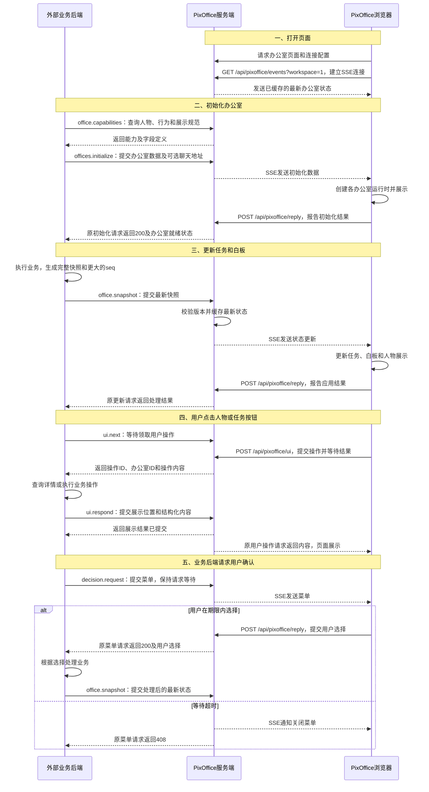
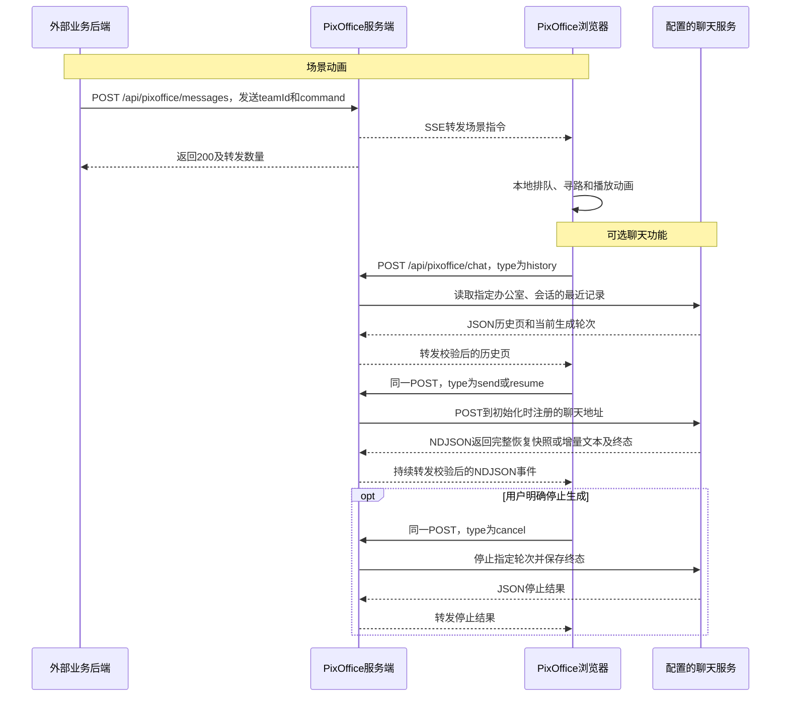
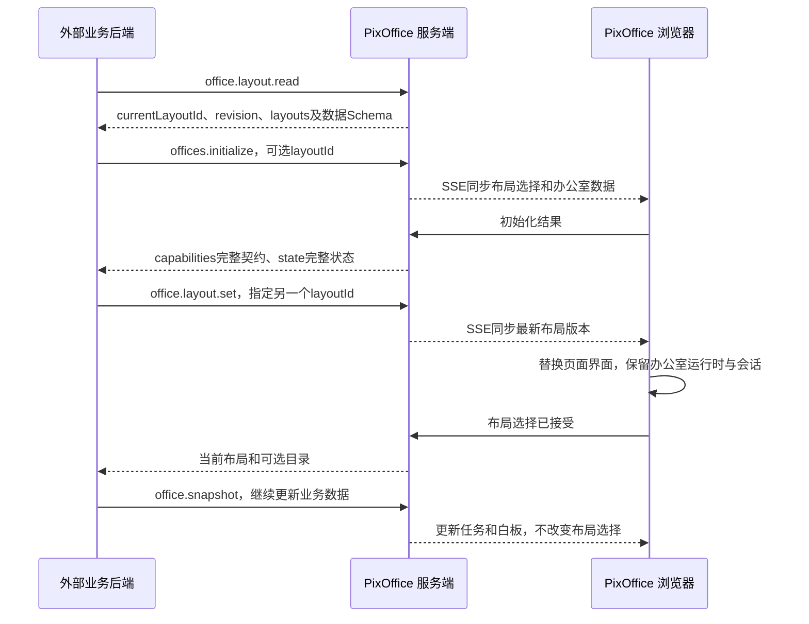
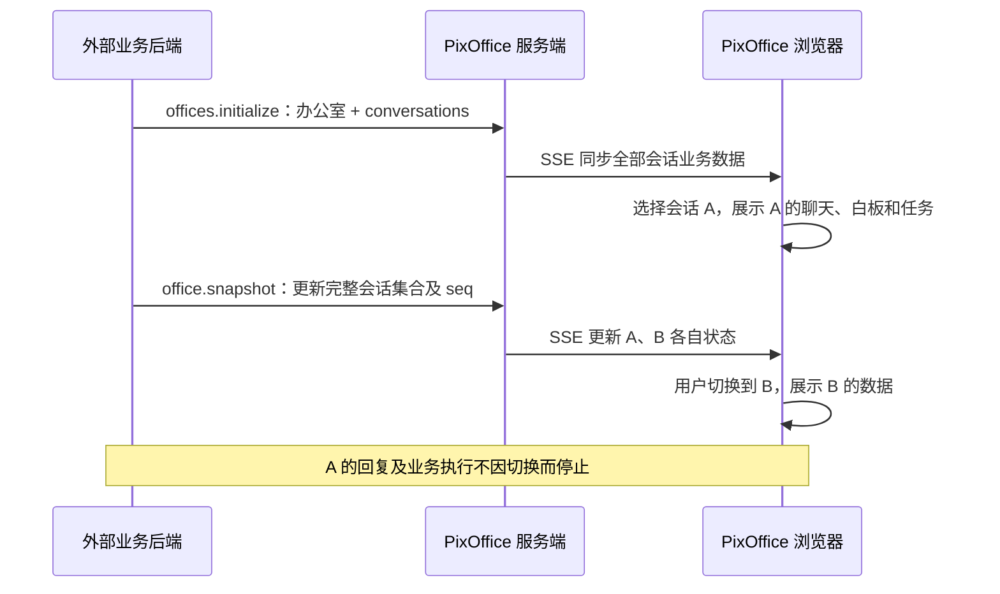

# PixOffice 办公室 HTTP 接入协议

本文面向将业务系统、智能体服务或任务平台接入 PixOffice 的开发者。通过本协议，可以创建办公室、展示成员与任务、更新白板、控制场景行为，以及接收用户操作。

## 通信参与方

| 名称 | 职责 |
| --- | --- |
| 外部业务后端 | 提供办公室、成员、任务和白板数据，执行业务操作，调用 PixOffice HTTP 接口 |
| PixOffice 服务端 | 本项目提供的 Fastify 服务，校验请求、缓存最新业务状态，并将消息发送给浏览器 |
| PixOffice 浏览器页面 | 展示办公室，执行人物动画，接收用户点击和选择 |

外部业务后端调用 PixOffice 服务端。PixOffice 服务端通过 SSE 向浏览器页面发送消息；SSE 是从服务器向浏览器持续发送事件的 HTTP 连接，由 PixOffice 自行建立和管理。

```text
外部业务后端 -- POST /api/pixoffice/messages --> PixOffice 服务端
PixOffice 服务端 -- SSE 消息 --> PixOffice 浏览器页面
外部业务后端 <-- 同一次 HTTP 请求的响应 -- PixOffice 服务端
```

## 完整调用流程

以下流程以服务器部署、浏览器页面在线为例。外部业务后端发送的 `office.capabilities`、`office.layout.read`、`office.layout.set`、`offices.initialize`、`office.snapshot`、`office.read`、`ui.next`、`ui.respond` 和 `decision.request`，均为 `POST /api/pixoffice/messages` 请求体中的 `type`。

图中的 `/api/pixoffice/events`、`/api/pixoffice/reply` 和 `/api/pixoffice/ui` 由 PixOffice 浏览器代码调用。各操作的字段定义见后续章节。



用户操作采用领取方式：外部业务后端持续调用 `ui.next`，处理领取到的操作后用 `ui.respond` 返回展示结果。`ui.next` 每次返回后可再次调用；到期没有操作时返回空列表。详情内容通过浏览器先前发起的 `/api/pixoffice/ui` 请求返回。

### 场景动画与可选聊天



动画请求的成功响应表示已转发，业务完成状态由外部业务后端决定。聊天服务由外部项目提供，通过初始化请求的 `chat.url` 注册；浏览器通过 PixOffice 服务端转发聊天，无需单独配置地址或重新构建前端。接口格式见[聊天流式接口](./chat-integration.md)。

聊天历史和生成状态由外部聊天服务保存。浏览器进入会话时按页同步历史，刷新后恢复同一轮回复；断开接收连接不等于停止生成。`send`、`history`、`resume`、`cancel` 共用已注册的聊天地址，不增加接口地址。

初始化和状态更新返回 `202` 时，表示最新状态已缓存，但该请求没有取得浏览器的应用确认。它可能发生于页面离线，也可能发生于等待浏览器确认的请求容量已满；后一种情况下，在线页面仍可通过 SSE 收到状态。浏览器上线或 SSE 重连时接收最新快照。服务端重启后，外部业务后端需要重新发送初始化。详细版本规则见下文“恢复与顺序”。

## 快速开始

需要 Node.js 22.13+ 或 24+。在项目根目录安装依赖并启动开发服务：

```sh
npm install
npm run dev
```

打开启动日志中 Vite 地址的 `/office/` 页面。在另一个终端运行业务接入示例：

```sh
npm run integration-example
```

该示例创建两个办公室、绑定业务成员、更新任务与白板，并等待用户在页面选择确认或拒绝。运行 `npm run integration-ui-example` 可以接收人物点击和任务按钮操作，并返回详情内容。示例源码位于 [`integration/clients/`](../clients/)。

执行 `npm run test:integration` 可运行独立 HTTP 客户端、真实浏览器和临时 Docker 服务之间的自动验收，覆盖初始化、用户操作、菜单、状态同步及异常恢复。环境要求、范围和报告位置见[端到端验收说明](../../tests/integration-e2e/README.md)。

示例客户端通过 `PIXOFFICE_URL` 指定 PixOffice 服务地址，默认 `http://127.0.0.1:8765`；通过 `PIXOFFICE_API_KEY` 指定访问密钥。开发环境默认密钥为公开演示值 `pixoffice-demo-key`。服务器与 Docker 配置见[消息转发与部署](./message-relay.md)。

下文请求示例使用 `team-a` 作为办公室 ID；首次调用时先执行“初始化办公室”，再发送该办公室的状态更新、菜单和场景指令。

## HTTP 地址与认证

所有办公室业务操作和场景指令都发送到同一个地址：

```http
POST <PixOffice 服务地址>/api/pixoffice/messages
```

每次请求设置以下请求头：

```http
Authorization: Bearer <PIXOFFICE_API_KEY>
Content-Type: application/json
```

将 `<PIXOFFICE_API_KEY>` 替换为与 PixOffice 服务端配置一致的密钥。

## 请求与响应格式

请求体为 JSON 对象。业务请求用 `type` 指定操作，其余字段是该操作的参数。例如，查询办公室 `team-a`：

```json
{ "type": "office.read", "teamId": "team-a" }
```

场景动画请求的顶层字段为 `teamId` 和 `command`，完整示例见下文“发送场景指令”。

每次 HTTP 请求都返回以下结构：

| 响应字段 | 类型 | 含义 |
| --- | --- | --- |
| `code` | 整数 | 与 HTTP 状态码一致 |
| `msg` | 字符串 | 供人阅读的结果说明；程序应根据 `code` 和业务字段判断结果 |
| `data` | 对象 | 该操作的返回数据；列表存放在对象内，例如 `data.state.offices`、`data.actions` |

例如，等待用户操作时暂时没有可领取的操作，返回：

```json
{ "code": 200, "msg": "OK", "data": { "actions": [] } }
```

失败响应的 `data` 包含 `reasonCode`、`details` 和 `issues`：

```json
{
  "code": 400,
  "msg": "Invalid business message",
  "data": { "reasonCode": "INVALID_MESSAGE", "details": {}, "issues": [] }
}
```

`reasonCode` 用于区分失败原因，`details` 提供补充信息，`issues` 提供字段校验问题。字段类型、必填项和取值范围的机器可读定义（JSON Schema），可通过 `office.capabilities` 查询。

### 通用数据规则

- 请求和响应的任何层级都禁止 `null`。字段必须符合各操作定义的类型。
- 可选字段可以省略。业务快照中的可选文本默认 `""`、列表默认 `[]`、在线标记默认 `false`，未知进度和资源指标默认 `-1`；对象按其字段定义补齐默认结构。
- 办公室 ID、任务名称、版本、时间等必填字段必须提供有效值。具体必填项见各操作及[业务快照字段说明](./dashboard-integration.md)。
- 办公室、场景人物、命令和交互 ID 使用 1–100 个字符，允许英文字母、数字、`_`、`.`、`:`、`-`。业务成员和任务 ID 为 1–100 个字符的非空字符串。
- 时间使用包含时区的 ISO 8601 格式，例如 `2026-10-18T10:00:00Z`。
- JSON 对象嵌套最多 64 层，禁止 `__proto__` 属性。办公室业务和场景指令的单次请求体最大 64 KiB；聊天请求使用独立接口，上限为 512 KiB。
- 业务请求只接受对应 JSON Schema 声明的字段；校验失败返回 `400`。

## 操作与返回时机

| 请求内容 | 返回时机 |
| --- | --- |
| `offices.initialize` | 取得浏览器逻辑初始化结果后返回 `200`；已缓存但未等待浏览器确认时返回 `202` |
| `office.snapshot` | 取得浏览器应用结果后返回 `200` 和 `applied`；已缓存但未等待浏览器确认时返回 `202` 和 `cached`；较旧状态返回 `200` 和 `ignored`；相同版本、相同内容可重试同步 |
| `office.read` | 返回完整能力与所有办公室状态，指定 `teamId` 时只返回该办公室；无在线页面时仍返回缓存快照 |
| `office.capabilities` | 服务端立即返回布局、动画、业务操作、UI 和聊天的完整契约，初始化前也可查询 |
| `office.layout.read` | 服务端立即返回当前页面布局、可选布局及各自的业务数据 JSON Schema |
| `office.layout.set` | 取得在线页面接受结果后返回 `200`；选择已缓存但未等待页面确认时返回 `202` |
| `chat.updated` | 通知指定会话读取最新聊天历史；投递到在线页面返回 `200`，没有可投递页面返回 `202`，不等待页面回执 |
| `ui.next` | 领取一个用户操作；等待时间内没有操作则返回 `data.actions: []` |
| `ui.respond` | 服务端接收指定用户操作的展示结果后返回 |
| `decision.request` | 等待用户选择后返回；到期返回 `408` |
| `{teamId, command}` | 指令发送到在线页面连接后返回 `200`；播放由浏览器随后执行 |

初始化、状态更新、布局切换和状态查询等待浏览器处理的默认时限为 10 秒。菜单等待时限默认 60 秒，`timeoutMs` 可设为 1000–300000 毫秒。外部业务后端和反向代理的 HTTP 超时应大于相应等待时限，例如为最长菜单配置 310 秒。

## 页面布局查询与切换

页面布局决定导航、成员和业务面板的排列，不改变办公室内部地图、人物身份或任务状态。目前提供 `classic`（经典布局）和 `members`（成员布局）。

### 获取当前布局与可选目录

独立查询可在办公室初始化前后调用：

```json
{ "type": "office.layout.read" }
```

`office.layout.read` 和 `office.layout.set` 的响应 `data` 包含以下字段：

| 字段 | 类型 | 含义 |
| --- | --- | --- |
| `currentLayoutId` | 字符串 | 当前选择的页面布局 ID |
| `revision` | 非负整数 | PixOffice 服务端生成的布局版本，用于自身状态同步；外部后端无需生成或提交 |
| `layouts` | 对象数组 | 当前可选布局目录 |
| `layouts[].id` | 字符串 | 可供选择的布局 ID |
| `layouts[].name` | 字符串 | 布局显示名称 |
| `layouts[].dataMessageType` | 字符串 | 该布局接收业务数据的操作类型，目前均为 `office.snapshot` |
| `layouts[].dataSchema` | 对象 | 该布局业务快照的完整 JSON Schema，包括必需字段、可选字段和默认值 |
| `layouts[].ui.slots` | 字符串数组 | 该布局支持的展示位置 ID，对应能力清单的 `ui.slots` |
| `layouts[].ui.actions` | 字符串数组 | 该布局可产生的用户操作，对应 `ui.actionSchema` |
| `layouts[].ui.localControls` | 字符串数组 | 浏览器本地交互，不是外部后端可发送的命令 |

初始化与全局 `office.read` 将动态选择放在 `data.state.layout`，可选目录放在 `data.capabilities.layouts`；独立 `office.capabilities` 返回 `data.layouts`。目录由同一份协议定义生成。经典布局支持人物悬停统计，成员布局不提供人物悬停统计，而使用成员侧栏；相同业务数据不代表两套布局的交互完全一致。

### 初始化指定与运行中切换

初始化时可增加 `layoutId`：

```json
{ "type": "offices.initialize", "offices": [], "layoutId": "members" }
```

此处 `offices: []` 表示不增加办公室，也不删除现有办公室。省略 `layoutId` 保留当前选择；服务实例首次启动时默认为 `classic`。

运行中单独切换，不需要重新初始化办公室或重新投递任务：

```json
{ "type": "office.layout.set", "layoutId": "classic" }
```

切换结果的 `data` 与 `office.layout.read` 使用相同结构。`200` 表示至少一个在线页面已接受该布局选择，不代表全部浏览器已经完成绘制；`202` 表示选择已缓存，页面上线或重连时恢复。请求重复指定同一布局不会增加布局版本。无效 ID 返回 `400`，不改变已有选择。



### 状态范围与数据投递

- 布局选择属于整个 PixOffice 服务实例，不属于某个 `teamId` 或会话。同一实例连接的浏览器页面共用选择；页面按钮切换也会更新服务端状态，因此后端查询可以看到用户的选择。
- 连接模式下，服务端状态优先于浏览器保存的布局偏好与 `?shell=` 参数。纯静态演示没有外部控制，仍使用本地偏好。`?layout=scene` 是仅展示场景的页面入口，不属于可选布局 ID。
- 目前两套布局都投影同一份办公室业务快照。后端继续使用 `office.snapshot` 投递，不需要按布局保存两份任务、成员或白板数据。布局目录分别提供各自的数据 Schema；以后增加专属数据要求时，应更新对应定义。
- 业务数据更新与布局选择是两个操作，`office.snapshot` 不接受 `layoutId`。向当前未显示的办公室更新数据不会切换页面布局。
- 切换布局不销毁办公室运行时、不取消人物活动，也不清除聊天记录、输入草稿或正在生成的回复。
- 服务端只在内存中保存最新布局选择，不保存切换历史。重连和新页面使用最新选择；服务端重启后恢复默认，外部后端可在重新初始化时指定布局。

`/api/pixoffice/layout` 是 PixOffice 浏览器按钮使用的同源内部接口，无需外部项目调用；外部后端的查询、初始化和切换继续共用 `/api/pixoffice/messages`。

## 1. 初始化办公室

`offices` 为办公室快照数组，每项包含办公室身份及完整业务状态：

一个办公室对应一个工作区，`conversations` 列出工作区中的会话。每个会话独立提供成员绑定、任务、动态和当前目标白板。浏览器首次选择目录中的第一个会话；之后保留用户选择，不因后端更新而自动跳转。

```json
{
  "type": "offices.initialize",
  "layoutId": "members",
  "chat": {
    "url": "https://your-host.example/chat"
  },
  "offices": [
    {
      "schemaVersion": "1.0",
      "seq": 1,
      "workspace": {
        "id": "team-a",
        "name": "研发办公室"
      },
      "conversations": [
        {
          "id": "main",
          "title": "登录模块开发",
          "employees": [
            {
              "id": "coding",
              "sceneActorId": "office-lead",
              "name": "代码开发",
              "online": true
            },
            {
              "id": "testing",
              "sceneActorId": "office-lead",
              "name": "自动化测试",
              "online": true
            }
          ],
          "tasks": [
            {
              "id": "task-1",
              "title": "登录模块开发",
              "assigneeId": "coding",
              "status": "running",
              "summary": "实现登录与权限校验。",
              "updatedAt": "2026-10-18T10:00:00Z"
            }
          ],
          "events": [],
          "whiteboard": {
            "template": "task-board-v1",
            "title": "",
            "status": "queued",
            "steps": []
          }
        }
      ]
    }
  ]
}
```

- `workspace.id` 是办公室的稳定 ID，其他操作的 `teamId` 引用该值。
- `chat` 可选，为本 PixOffice 服务实例注册聊天接口；`url` 为服务端可访问的完整 HTTP(S) 地址。省略 `chat` 保留已有配置，`chat: { "url": "" }` 停用服务。可使用 `offices: []` 单独更换聊天地址，后续聊天立即生效；配置独立于快照 `seq`，服务端重启后须重新注册。地址只保存在 PixOffice 服务端，不广播给浏览器。详见[聊天接入文档](./chat-integration.md)。
- `conversations[].id` 是办公室内唯一的会话 ID，`title` 是标签显示名称。聊天请求、审批请求及用户操作使用 `conversationId` 引用该 ID。
- `conversations[].employees` 是会话的业务成员列表，可代表员工、功能或智能体。成员 `id` 在该会话内唯一；`sceneActorId` 指定负责展示该成员的场景人物。多个成员可以绑定同一人物，不同会话可有不同的绑定关系。
- 每个办公室提供固定六个人物及对应工位、外观。可绑定人物通过 `office.capabilities` 的 `data.scene.actors`，或初始化结果的 `data.capabilities.scene.actors` 查询。
- 初始化按 `workspace.id` 新增或更新办公室。请求未列出的办公室保留；此操作不提供删除办公室功能。一个服务实例最多管理 100 个办公室。
- 新增办公室时，其他办公室继续执行各自活动。更新已有办公室使用完整快照和 `seq` 规则，见下文“恢复与顺序”。
- 返回 `data.capabilities`（完整接口契约）和 `data.state`（当前状态），字段定义见下表。初始化后无需额外调用能力查询即可得到同一份契约。

### 初始化响应结构

| 字段 | 内容 |
| --- | --- |
| `data.capabilities` | 与独立 `office.capabilities` 的 `data` 完全同构：布局目录、人物与物品定义、动画参数和参与者要求、业务请求与返回 Schema、UI 展示格式、聊天四种操作及流事件契约 |
| `data.state.layout` | `{currentLayoutId, revision}`，当前布局及服务端生成的版本 |
| `data.state.chat.configured` | 聊天服务地址是否已注册；不表示上游服务健康检查通过，不返回地址或密钥 |
| `data.state.offices[].snapshot` | 服务端保存的最新完整办公室快照，包含 `seq`、`workspace`、所有 `conversations` 及 `system`；每个会话包含成员、任务、动态、白板 |
| `data.state.offices[].runtime.available` | 是否取得与该快照版本匹配的在线页面运行状态 |
| `data.state.offices[].runtime.selectedConversationId` | 响应页面在此办公室选择的会话 ID；不可用时为 `""` |
| `data.state.offices[].runtime.actors` | 人物 ID、名称、外观 ID、当前格子坐标和工作展示状态 |
| `data.state.offices[].runtime.objects` | 物品 ID、名称、模板 ID、当前状态和状态版本，以及当前物品的交互目录 |
| `data.state.offices[].runtime.pendingDecisions` | 此办公室尚待选择的菜单 ID 列表 |

`snapshot` 是业务事实，`runtime` 是一个在线浏览器处理请求时的采样，不是所有页面的共同视图，也不保证图片资源已经完成绘制。不同页面可选择不同会话。若页面应用状态失败，或回复采样版本与服务端最新 `seq` 不一致，返回最新 `snapshot`，并将 `runtime` 标为不可用，不拼接失败或过期的运行状态。

返回 `202` 或没有在线浏览器时，仍给出完整能力清单与所有缓存快照，运行状态统一为：

```json
{
  "available": false,
  "selectedConversationId": "",
  "actors": [],
  "objects": [],
  "pendingDecisions": []
}
```

能力清单只描述本项目提供的功能，不包含模型密钥、聊天正文、浏览器输入草稿或内部消息队列。聊天历史由聊天服务按会话提供；初始化中的 `chat` 契约给出读取方式。

### 人物历史统计（可选）

`conversations[].employees[].insights` 提供成员历史统计，随初始化及完整 `office.snapshot` 同步，并参与现有 `seq` 顺序控制与重连恢复。省略此字段时，人物弹窗显示“暂无历史统计”。不需要新增 HTTP 接口、悬停回调或动画回执。

统计由外部业务后端汇总。`scope` 为 `conversation`（当前会话）或 `office`（本办公室），`updatedAt` 为含时区的 ISO 时间；`periods` 支持 `last7Days`、`last30Days`，每种最多一项。业务成员 ID 及其 `sceneActorId` 仍由所在 `employees` 项指定。多个成员绑定同一人物时，弹窗分别展示，不自动合并统计。

以下为一个成员的 `insights` 字段示例：

```json
{
  "scope": "conversation",
  "updatedAt": "2026-10-22T10:00:00+08:00",
  "periods": [{
    "id": "last7Days", "label": "近 7 天",
    "metrics": [{ "id": "completed", "label": "完成任务", "value": 28, "unit": "项" }],
    "blocks": [{
      "id": "daily", "type": "trend", "title": "完成趋势", "unit": "项",
      "points": [{ "label": "10/21", "value": 5 }, { "label": "10/22", "value": 8 }]
    }]
  }]
}
```

- 每个时间范围最多 4 个 `metrics`、4 个 `blocks`；同组项目 `id` 唯一。指标及完整统计遵循数组顺序；悬停概览选取首个图表区块和首个动态区块。
- 指标 `value` 为非负有限数值，`-1` 表示未知，页面显示“暂无数据”，不等同于零。可选 `changePercent` 表示相对上一等长周期的变化百分比；`sentiment` 为 `positive`、`negative` 或 `neutral`，决定变化的语义颜色，默认中性。
- `trend`：`points: [{label, value}]`，1～31 个非负数据点，可选 `unit`。
- `bars`：`items: [{label, value}]`，1～8 项，可选 `unit`。
- `distribution`：`items: [{label, value}]`，1～6 项；前端按实际合计计算占比，合计为零时显示空环。
- `activity`：`items: [{label, occurredAt, status}]`，最多 5 条；`status` 为 `completed`、`running`、`blocked` 或 `failed`。
- 标签只支持纯文本，不接受 HTML、脚本、CSS 或自定义组件。所有字段均不得为 `null`。完整校验规则可从 `office.capabilities` 的请求 Schema 获取。
- 前端按区块类型渲染，不按 agent 名称或职责硬编码。悬停读取已同步的数据，不产生网络请求；“完整统计”展开已提供的其他区块。“更多操作”对当前所选成员发出 `employee.inspect`，未绑定成员时使用 `actor.inspect`，沿用现有用户操作链路。
- 统计必须使用真实业务历史，不以展示动画进度推算。PixOffice 不新增历史数据库；本地演示统计不代表实际 agent 执行结果。

## 2. 更新任务与展示状态

```json
{
  "type": "office.snapshot",
  "teamId": "team-a",
  "snapshot": {
    "schemaVersion": "1.0",
    "seq": 2,
    "workspace": {
      "id": "team-a",
      "name": "研发办公室"
    },
    "conversations": [
      {
        "id": "main",
        "title": "登录模块开发",
        "employees": [
          {
            "id": "coding",
            "sceneActorId": "office-lead",
            "name": "代码开发"
          }
        ],
        "tasks": [
          {
            "id": "task-1",
            "title": "登录模块开发",
            "assigneeId": "coding",
            "status": "completed",
            "progress": 100,
            "summary": "实现登录与权限校验。",
            "updatedAt": "2026-10-18T10:05:00Z"
          }
        ],
        "events": [],
        "whiteboard": {
          "template": "task-board-v1",
          "title": "",
          "status": "queued",
          "steps": []
        }
      }
    ]
  }
}
```

`snapshot` 表示该办公室在此版本下的完整业务状态，包含全部需要保留的会话；数组内容替换对应列表，省略的可选字段使用默认值。`teamId` 必须等于 `snapshot.workspace.id`，办公室必须已初始化。任务和白板放在 `conversations[]` 内，不接受顶层同名字段。完整字段、数量限制和状态见[业务快照规范](./dashboard-integration.md)。

外部业务后端负责汇总该办公室的完整数据，并为每次更新生成更大的 `seq`。PixOffice 根据 `seq` 选择最新状态，因此 HTTP 请求可以乱序到达。

浏览器只将当前会话投影到墙上白板、人物任务和任务列表，其他会话的数据继续接收。切换会话不重新初始化办公室，不停止其他会话的聊天或外部业务执行。流程如下：



成功响应的 `data` 包含 `teamId`、`seq`、`status`。`status` 为 `applied`、`cached` 或 `ignored`，分别表示浏览器已确认应用、服务端已缓存但未取得浏览器确认、版本未更新；忽略原因由 `reasonCode` 给出。`cached` 和 `ignored` 均不证明页面已经应用该版本。

任务状态、简介和业务进度由外部业务后端维护。电脑旁的进度条是活动展示：进行中最多显示 99%，收到 `completed` 后显示 100% 并保留完成内容；任务列表使用快照中的真实进度。多个成员绑定同一人物时的任务展示规则见[业务快照规范](./dashboard-integration.md)。

人物空闲时可播放场景定义的闲时动作。具体表现由前端人物素材决定，不由外部业务后端选择“喝咖啡”等动画细节；没有专用素材时保持自然待机。闲时表现不占用动作队列，工作、移动或交谈会立即取代它，不需要新增请求、业务状态字段或播放确认。

用户点击任务按钮后，外部业务后端通过 `ui.next` 接收操作，处理完成后发送新快照，流程见“处理用户操作”。

## 3. 请求用户确认或选择

```json
{
  "type": "decision.request",
  "teamId": "team-a",
  "timeoutMs": 60000,
  "decision": {
    "id": "decision-1",
    "actorId": "office-lead",
    "kind": "confirmation",
    "title": "是否提交登录模块？",
    "description": "请检查实现结果后决定。",
    "confirmLabel": "确认提交",
    "rejectLabel": "暂不提交"
  },
  "conversationId": "main"
}
```

多选项菜单使用以下请求，允许 2–8 个选项：

```json
{
  "type": "decision.request",
  "teamId": "team-a",
  "timeoutMs": 60000,
  "decision": {
    "id": "decision-2",
    "actorId": "office-lead",
    "kind": "choice",
    "title": "下一步如何处理？",
    "description": "请选择处理方式。",
    "options": [
      {
        "id": "submit",
        "label": "提交",
        "description": "进入下一阶段"
      },
      {
        "id": "revise",
        "label": "继续修改",
        "description": "补齐问题后再提交"
      }
    ]
  },
  "conversationId": "main"
}
```

`conversationId` 必填，必须是该办公室已登记的会话，否则返回 `404 CONVERSATION_NOT_FOUND`。`decision.id` 为该办公室内本次菜单的唯一标识，每次发起新菜单应使用不同值，即使分属不同会话也不能重复。选项 ID 在该菜单内唯一。`actorId` 可省略，默认使用第一个场景人物；人物姓名和头像由 PixOffice 根据人物 ID 确定。

用户选择后，发起菜单的 HTTP 请求返回：

```json
{
  "code": 200,
  "msg": "User selected",
  "data": {
    "teamId": "team-a",
    "decisionId": "decision-1",
    "choiceId": "confirm",
    "label": "确认提交",
    "conversationId": "main"
  }
}
```

确认菜单返回 `choiceId: "confirm"` 或 `"reject"`；多选项菜单返回所选选项的 ID。`label` 为对应按钮标签。收到结果后，由外部业务后端执行业务操作并发送更新后的快照。

菜单在每个会话内排队，会话之间独立，切换后保留原有效期限。当前会话的菜单显示在办公室底部；展开聊天后，顶部会话标签显示各会话的待处理数量。非当前办公室的菜单会在场景左侧显示，可直接提交，也可进入对应办公室和会话查看上下文。结果携带原请求的 `teamId`、`conversationId` 和 `decisionId`。空间总览显示各办公室的待选择数量。页面显示倒计时，到期关闭菜单并返回 `408`，不产生默认选择。当前接口不提供菜单请求重试去重或历史结果查询；网络中断后，调用方应根据业务状态决定是否发起新菜单。

## 4. 查询初始化和当前任务

```json
{ "type": "office.read" }
```

省略 `teamId` 或使用 `teamId: ""` 时，返回完整工作区信息。`data` 与初始化结果使用同一结构：`{capabilities, state}`。没有办公室时 `state.offices` 为 `[]`，能力契约仍完整返回。

查询指定办公室：

```json
{ "type": "office.read", "teamId": "team-a" }
```

返回 `data.snapshot` 和 `data.runtime`，与全局结果的 `state.offices[]` 相同。办公室未在当前服务端初始化时返回 `404 OFFICE_NOT_INITIALIZED`；已初始化但无在线页面时返回 `200`、最新缓存快照和 `runtime.available: false`。在线页面无法在时限内回复时返回 `408`。

### 查询能力与字段 Schema

```json
{ "type": "office.capabilities" }
```

返回的 `data` 包含：

| 字段 | 内容 |
| --- | --- |
| `layouts` | 可选布局、各自业务数据 Schema、展示位置、用户操作与本地交互 |
| `scene` | 固定人物和物品定义、物品交互目录及状态 Schema、场景命令及批次 Schema、行为参数、参与者角色和人数限制；不含实时坐标和状态 |
| `ui` | 展示位置、内容格式、用户操作及白板的 JSON Schema |
| `chat` | 聊天服务调用方向和配置入口、`send/history/resume/cancel` 的请求及成功响应 Schema、NDJSON 事件、超时和大小限制 |
| `http` | 业务入口、方法、鉴权方式、请求大小上限、等待浏览器处理的时限 |
| `animation` | 动画投递请求与成功响应 Schema、尽力展示与不回报播放完成的语义 |
| `supportedMessages` | 可提交的业务操作类型 |
| `requests` | 业务请求的 JSON Schema |
| `responses.envelope` | `{code, msg, data}` 完整响应的通用 Schema |
| `responses.success`、`responses.error` | 成功数据联合 Schema、错误数据 Schema，均用于校验响应 `data` |
| `responses.operations[]` | 按 `type` 列出成功 HTTP `codes` 及对应 `dataSchema`；`office.read` 以 `scope: workspace/office` 区分全局和指定办公室，其余操作为 `operation` |
| `rules` | 序号、引用、运行状态采样、动画与菜单等跨字段语义要求 |

初始化之前即可调用该操作，结果与初始化的 `data.capabilities` 一致。当前布局和聊天是否配置等动态值只放在 `state`，不混入能力定义。指定办公室的实时场景状态通过 `office.read` 查询。

`chat.operations[].responseSchema` 对 `send/resume` 校验每一行 NDJSON 事件，对 `history/cancel` 校验完整 JSON 响应。流式响应开始前的错误使用 `responses.envelope` 与 `responses.error`；开始后的错误使用聊天 `error` 事件。`chat.operations[].timeoutMs` 是当前服务实例实际使用的时限。所有操作均携带办公室和会话身份，`turnId` 只用于发送、恢复和停止，历史查询使用游标。

完整可执行查询示例见 [`discovery-client.mjs`](../clients/discovery-client.mjs)。它只查询，不创建或修改办公室，并将完整响应输出为 JSON。

### 家具交互目录

初始化的 `data.capabilities.scene.objects[].interactions` 和独立能力查询的 `data.scene.objects[].interactions` 描述内置家具的交互方式。指定办公室查询的 `data.runtime.objects[].interactions` 来自在线页面当前场景，包括用户编辑后的物品和工位归属。

```json
{
  "id": "desk-0",
  "name": "王明的工位",
  "templateId": "office.reference-workstation",
  "interactions": [
    { "id": "seat", "name": "入座工作", "requiresHome": true, "actorIds": ["office-lead"] }
  ]
}
```

上例展示目录相关字段；能力查询中的物品还包含 `stateSchema`，运行状态中的物品还包含 `state` 和 `stateRevision`。

| 字段 | 含义 |
| --- | --- |
| `interactions[].id` | `furniture.use.params.interactionId` 的可用值 |
| `interactions[].name` | 交互名称 |
| `interactions[].requiresHome` | 是否要求人物绑定此物品为自己的工位 |
| `interactions[].actorIds` | 按工位归属规则允许使用此交互的人物 ID；空数组表示当前没有符合条件的人物 |

`interactions: []` 表示物品没有 `furniture.use` 交互，例如当前会议桌。参与者仍使用 `role: "user"`，命令如下：

```json
{
  "teamId": "team-a",
  "command": {
    "protocolVersion": "2.0", "sceneId": "team-a", "commandId": "seat-1",
    "type": "activity.start", "capability": "furniture.use",
    "participants": [{ "entityId": "office-lead", "role": "user" }],
    "params": { "objectId": "desk-0", "interactionId": "seat", "durationMs": 4000 }
  }
}
```

目录给出固定使用条件，人物忙碌、路径可达和动作素材支持仍由浏览器运行时判断，沿用动画尽力展示、不回报播放完成的规则。

### 聊天更新通知

外部聊天服务保存新内容后，通过同一业务入口发送 `{ "type": "chat.updated", "teamId": "team-a", "conversationId": "main" }`，通知页面读取最新聊天历史。此操作不携带正文、不修改快照版本、不等待浏览器回执，详细流程见[聊天协议的主动更新通知](./chat-integration.md#后端主动通知更新)。

请求、展示内容、白板、场景行为参数和物品状态的 Schema 描述可提交的输入：带默认值的字段可以省略。响应 Schema 描述返回的数据：应补齐的默认字段会实际出现在响应中。身份及跨字段引用约束同时由服务端校验。

## 5. 固定格式白板

通过 `offices.initialize` 或 `office.snapshot` 的 `conversations[].whiteboard` 设置各会话白板，场景显示当前所选会话的白板。白板内容示例：

```json
{
  "template": "task-board-v1", "title": "登录模块开发", "status": "running",
  "description": "实现登录、权限校验和测试。", "note": "先跑通核心流程。",
  "steps": [{ "id": "develop", "title": "功能开发", "progress": 66 }]
}
```

白板使用 `task-board-v1` 模板，最多显示 3 个阶段。PixOffice 决定布局、字体和颜色；外部业务后端提供文字、状态、阶段进度和可选链接。支持字段及长度限制由 `office.capabilities` 的 `data.ui.whiteboardSchema` 给出。

`title: ""` 表示清空白板。省略 `whiteboard` 或传 `{}` 时使用以下默认内容；发送其他业务更新并希望保留白板时，需在完整快照中携带当前白板内容：

```json
{
  "template": "task-board-v1", "title": "", "status": "queued",
  "tagline": "", "description": "", "note": "",
  "link": { "label": "", "url": "" }, "steps": []
}
```

白板与任务共用办公室快照的 `seq`。阶段 `progress` 的范围为 0–100，省略时默认为 `-1`，表示进度未知。白板文字按模板渲染；内容字段为普通文本。

浏览器使用展示进度：`running` 时从阶段进度开始持续增长，越接近完成越慢，最多显示 99%；只有白板 `status: "completed"` 才将各阶段显示为 100% 并呈现已完成状态。`queued`、`blocked` 和 `failed` 不自动增长。墙上白板与放大窗口共用该展示进度，切换窗口不重新开始。展示值不会写回业务快照、接口查询或下载数据。当前白板没有逐阶段的独立状态；后端无需增加字段或发送定时进度更新。

从 0% 开始时，当前默认展示节奏约为：30 秒 28%、1 分钟 48%、2 分钟 72%、3 分钟 85%、5 分钟 95%、10 分钟 98%。已有阶段进度作为起点，后续收到更高进度时向前更新，不倒退；收到完成状态时立即显示 100%。该节奏只用于前端视觉反馈，不表示真实业务完成比例，也不要求后端按此频率发送更新。

## 6. 处理用户操作

用户点击人物、成员列表、任务按钮或详情选项时，浏览器将操作发送给 PixOffice 服务端。外部业务后端调用 `ui.next` 领取操作，处理后调用 `ui.respond` 返回展示内容：

```text
用户操作 -> 浏览器提交操作 -> PixOffice 服务端暂存
外部业务后端调用 ui.next -> 取得操作并处理
外部业务后端调用 ui.respond -> 浏览器展示结果
```

领取请求：

```json
{ "type": "ui.next", "timeoutMs": 30000 }
```

`timeoutMs` 为 1000–30000 毫秒，默认 30000。等待期间有操作时立即返回，例如：

```json
{
  "code": 200,
  "msg": "OK",
  "data": {
    "actions": [
      {
        "id": "action-1",
        "teamId": "team-a",
        "action": "actor.inspect",
        "actorId": "office-lead",
        "conversationId": "main"
      }
    ]
  }
}
```

`data.actions` 最多一项；等待到期没有操作时为空数组。需要持续处理操作的客户端在每次返回后发起下一次 `ui.next` 请求。

`action` 指定用户操作类型：

| `action` | 业务字段 |
| --- | --- |
| `actor.inspect` | `actorId`：场景人物 ID |
| `employee.inspect` | `employeeId`：业务成员 ID |
| `task.start`、`task.block`、`task.complete` | `taskId`：任务 ID |
| `task.assign` | `taskId`、`assigneeId`：任务及新负责人 ID |
| `dialog.action` | `interactionId`：原详情请求 ID；`optionId`：详情按钮 ID |
| `conversation.delete` | 使用操作中的 `teamId`、`conversationId` 指定待删除会话，无额外业务字段 |

每项操作还包含 `id`、`teamId` 和 `conversationId`，后端按办公室及会话定位成员和任务。将操作的 `id` 作为 `ui.respond.interactionId`，返回展示结果：

```json
{
  "type": "ui.respond", "interactionId": "action-1",
  "presentation": {
    "target": "dialog",
    "content": { "template": "detail-v1", "title": "王明的任务", "description": "正在开发登录模块。", "fields": [{ "label": "进度", "value": "66%" }], "actions": [{ "id": "review", "label": "提交审核" }] }
  }
}
```

`presentation.target` 支持以下处理方式：

| `target` | 参数 | 展示方式 |
| --- | --- | --- |
| `dialog` | `content` | 在详情对话框中展示 `detail-v1` 内容，包含标题、描述、字段列表和最多 8 个按钮 |
| `whiteboard` | `snapshot` | 应用所属办公室的新版本完整快照，更新其中的白板和其他业务状态 |
| `result` | `success`、`message` | 返回操作是否成功及原因，不打开详情对话框 |

`ui.respond` 成功返回 `data: {interactionId, delivered: true}`。用户点击详情按钮会产生新的 `dialog.action` 操作，使用该新操作的 `id` 提交对应展示结果。

详情对话框仅在请求所属会话仍被选中时显示，迟到结果不会覆盖另一个会话。白板展示结果必须携带包含请求所属会话的完整办公室快照；服务端缓存全部会话，浏览器只显示所选会话的数据。

用户操作最多保留并等待处理 60 秒，超时后页面提示失败，后续 `ui.respond` 返回 `410 UI_REQUEST_EXPIRED`。领取后的操作不会再次返回给其他 `ui.next` 请求。任务按钮的实际业务处理由外部业务后端执行，处理后通过 `office.snapshot` 同步结果。

### 删除会话

用户确认删除后，外部后端通过 `ui.next` 取得 `conversation.delete` 操作。后端决定关联执行、任务和审批如何收尾。允许删除时，先发送更高 `seq` 的完整 `office.snapshot`，从 `conversations` 中移除目标会话，再提交成功结果：

```json
{
  "type": "ui.respond",
  "interactionId": "delete-action-1",
  "presentation": { "target": "result", "success": true, "message": "会话已删除" }
}
```

成功确认前，PixOffice 服务端检查最新快照中已无该会话；仍存在时返回 `409 SNAPSHOT_REQUIRED`，删除请求继续等待处理。外部后端无需新增接口。会话 ID 不应复用。

拒绝删除时，不移除快照中的会话，返回原因：

```json
{
  "type": "ui.respond",
  "interactionId": "delete-action-1",
  "presentation": { "target": "result", "success": false, "message": "会话仍有受保护操作，暂时不能删除" }
}
```

外部后端处理删除时应一并停止该会话的回复生成并删除已保存的聊天历史。浏览器仅在成功确认后清除聊天记录、草稿及该会话的本地决策记录，断开接收连接。拒绝或超时会保留本地记录并显示原因。本地演示会话无需后端确认。

## 7. 发送场景指令

在办公室初始化且页面在线后，可以向场景人物发送行为指令。以下示例让 `office-lead` 发言：

```json
{
  "teamId": "team-a",
  "command": {
    "protocolVersion": "2.0", "sceneId": "team-a", "commandId": "say-1",
    "type": "activity.start", "capability": "scene.say",
    "participants": [{ "entityId": "office-lead", "role": "actor" }],
    "params": { "text": "开始处理任务。", "durationMs": 2000 }
  }
}
```

`teamId` 与命令的 `sceneId` 必须一致。每条新指令使用唯一 `commandId`；人物 ID、行为名称、角色及参数通过能力查询获取。指令也可按顺序或并行组成最多 32 条的批次，详见[场景协议](../../docs/plugin-runtime.md)。

可在请求顶层增加 `conversationId`，将临时动画限定到该会话；浏览器当前未选择该会话时跳过，不缓存补播。省略时表示办公室级动画。切换会话不撤销已经接收的办公室动画；持续的工作状态应通过会话任务快照表达，无需逐帧控制或动画回执。

HTTP `200` 表示指令已发送到至少一个在线页面连接。浏览器负责排队、寻路、资源占用和动画播放；本接口不返回动画开始或完成通知，业务流程应以外部业务后端的状态为准。无在线页面返回 `409`。

办公室白板由业务快照统一管理。对已初始化办公室的墙面白板发送 `object.state.set` 会返回 `400 SNAPSHOT_REQUIRED`，应改用 `office.snapshot`。

## 恢复与顺序

每个办公室使用独立的 `seq`，取值为 1–9007199254740991 的整数。外部业务后端将每个新快照的 `seq` 设为大于此前版本的值，并在自身重启后保持版本连续。多个智能体共享一个办公室时，由业务后端汇总状态并生成版本。

| 收到的版本 | 处理结果 |
| --- | --- |
| 大于当前 `seq` | 应用完整快照 |
| 小于当前 `seq` | 保留当前状态，结果标为 `ignored` / `STALE_SEQ` |
| 等于当前 `seq` 且补齐默认值后的内容相同 | 重新同步到浏览器；确认应用后返回 `200` / `applied`，未取得应用确认时返回 `202` / `cached` |
| 等于当前 `seq` 且补齐默认值后的内容不同 | 返回 `409 SEQ_CONFLICT` |

PixOffice 服务端在内存中缓存每个办公室的最新完整快照，最多 100 个办公室、合计 8 MiB。浏览器首次连接或 SSE 重连时，服务端发送最新快照；浏览器应用完成后显示已连接。浏览器保存本地快照用于连接前的临时展示，连接后的办公室目录以服务端为准。全局查询只返回当前服务端已初始化的办公室，`runtime.available: true` 还要求在线页面确认了该办公室的当前版本。

PixOffice 服务端重启会清空内存缓存，外部业务后端需要重新发送初始化。浏览器自动识别服务端状态已重建，移除旧目录并同步新的初始化数据；同一服务的正常重连会保留已有运行时。临时动画和待选择菜单只向在线页面发送，不保存为离线待办；刷新页面后不补播历史动画。

### 请求失败与重试的含义

服务端先缓存有效快照，再等待浏览器应用。等待超时、连接中断或浏览器应用失败时，该快照仍可能保留在服务端缓存中；错误响应不表示状态已回滚。

对于 `office.snapshot` 和 `offices.initialize`，等待超时、连接中断或页面应用失败后，可以使用相同 `seq` 和相同内容重试。服务端会重新发送快照，页面会重新核对并应用状态；已应用的内容不会重复写入，正在执行的行为不会因重试而重建，历史交接动画不会重播。初始化重试会同步相同版本及新版本的办公室，忽略较旧版本的输入。

`office.snapshot` 重试取得页面应用确认后返回 `200` 和 `status: "applied"`；页面离线或等待请求容量已满时返回 `202` 和 `status: "cached"`，不代表页面已应用。重复发送仍可能遇到相同的应用错误或超时，此时应按错误原因排查。内容发生变化时必须增加 `seq`，不能在相同 `seq` 下修改内容。

收到 `404 OFFICE_NOT_INITIALIZED` 时，外部业务后端应发送该办公室的完整初始化数据，再继续提交状态更新。这通常用于恢复服务端重启后丢失的内存目录。

## HTTP 状态与错误处理

| HTTP / `code` | 含义及调用方处理 |
| --- | --- |
| `200` | 请求处理成功；结合各操作的返回字段判断应用、忽略或动画转发结果 |
| `202` | 最新业务状态已缓存，但本次请求未取得浏览器应用确认；页面可能离线或在线 |
| `400` | 请求格式、字段、ID 引用或操作方式无效；根据 `reasonCode`、`issues` 修正 |
| `401` / `403` | 密钥无效或访问被拒绝 |
| `404` | 指定办公室或人物不存在 |
| `408` | 等待浏览器处理或用户选择超时 |
| `409` | 状态版本冲突、菜单 ID 冲突或没有在线接收者；以 `reasonCode` 区分 |
| `410` | 用户操作已结束或超时 |
| `413` | 请求或补齐默认字段后的快照超出大小限制 |
| `422` | 浏览器处理业务数据失败 |
| `500` | PixOffice 内部处理失败 |
| `503` | 队列、缓存、连接或发送缓冲达到上限，或接收方暂不可用 |

当前接口提供菜单和用户操作的单次处理结果，不提供网络重试的业务去重保证或已结束结果查询。涉及审批、扣费等业务时，由外部业务后端记录和核验业务结果。

## 部署与参考资料

一个 PixOffice 服务实例管理一个共享工作区。多个浏览器页面可同时查看，菜单以最先收到的有效选择为准。服务端使用单进程内存保存状态；多租户隔离及跨实例状态共享需要由部署方扩展。部署参数、浏览器内部通道和容量限制见[消息转发与部署](./message-relay.md)。

公网部署时配置私有 `PIXOFFICE_API_KEY`、HTTPS 及页面和浏览器消息接口的访问控制。模型调用和审批等业务逻辑由外部业务后端实现。对话输入框的流式回复接入见[聊天接口](./chat-integration.md)。

字段定义以 [`@pixoffice/protocol/office-integration`](../../packages/protocol/src/office-integration.ts) 及关联 Schema 为准。本文示例用于说明请求和响应的用法；完整客户端见[业务操作示例](../clients/client.mjs)和[用户操作示例](../clients/ui-client.mjs)。
